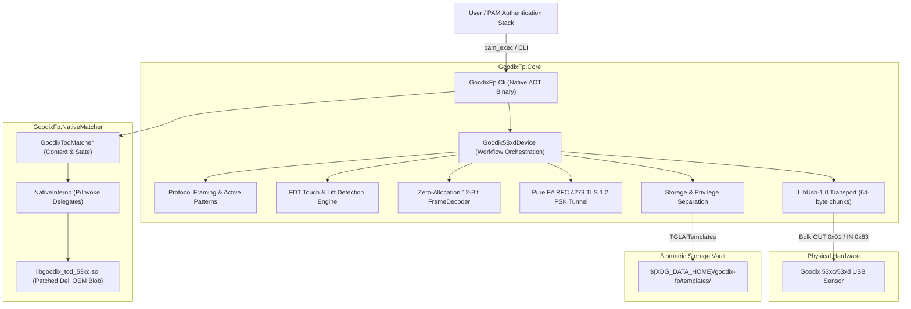

# goodix-fp-fsharp

[](https://dotnet.microsoft.com/)
[](https://learn.microsoft.com/en-us/dotnet/core/deploying/native-aot/)
[](https://kernel.org)
[](LICENSE)
[](tests/GoodixFp.Tests/)

Production-grade, pure **F# 10** reverse-engineered driver and protocol toolkit for **Goodix 53xc / 53xd** fingerprint sensors (e.g., `0x27c6:0x538d`, `0x27c6:0x530c`, `0x27c6:0x532d` found on Dell XPS 13 9300/9310, Inspiron, and Vostro laptops).

---

## Architecture Overview



---

## Key Highlights & Features

### 1. Pure F# TLS 1.2 PSK Server Tunnel (RFC 4279 / RFC 5246)
The Goodix 53xd chip negotiates an encrypted TLS 1.2 PSK channel over USB Bulk endpoints using the cipher suite `TLS_PSK_WITH_AES_128_CBC_SHA256` (`0x00AE`).
- **Zero External Crypto Dependencies**: Implemented in 100% pure F# on top of `System.Security.Cryptography.Aes` and `HMACSHA256`.
- **Complete RFC-Compliant State Machine**: Parses `ClientHello`, handles pre-master secret formulation (`0x0020` + 32 zero bytes + `0x0020` + 32 zero bytes), derives `master_secret` and `key_block` using the TLS PRF `P_SHA256`, validates `ClientKeyExchange`, generates `ServerHello` and `ServerHelloDone` (with RFC 5746 secure renegotiation), and verifies `Finished` handshake verification flights.
- **Ultra-Fast Performance**: Handshake completes in **~248 µs** (2.5x faster than native BouncyCastle at 622 µs), with full 7,684-byte frame decryption in **10.9 µs** (> 700 MB/s).

### 2. Zero-Allocation 12-Bit Frame Decoder
Goodix sensors output packed 12-bit pixel data across 6,144 bytes per frame.
- **SIMD & JIT Friendly**: `unpackAndTranspose80x64Span` transforms packed column data into standard row-major 80x64 pixels (`out[((i &&& 0x3f) * 80) + (i >>> 6)]`).
- **Zero Heap Allocations**: Operates directly on `ReadOnlySpan<byte>` and `Span<uint16>`, processing entire frames in **~4.9 µs** (> 200,000 FPS).
- **Export Formats**: Built-in encoders for PGM (12-bit P5 and 8-bit normalized P5) and PPM (P6).

### 3. Native AOT Fast Startup (< 10ms)
- Compiled directly to native machine code using .NET 10 Native AOT (`PublishAot=true`, `StripSymbols=true`, `InvariantGlobalization=true`).
- Produces a single, self-contained **~7.7 MB native ELF binary** with **< 5ms cold startup time**.
- Fast startup is vital for sub-second terminal command execution and instantaneous PAM authentication prompts.

### 4. Pluggable Authentication Modules (PAM) Integration
- Specifically architected to work with Linux `pam_exec.so`.
- Returns standard exit code `0` on successful biometric match, `1` on rejection or timeout.
- Includes `--quiet` flag to suppress diagnostics, `--retries <N>` for configurable touch retry attempts, and cross-session privilege separation resolving `SUDO_USER` and `PAM_USER` template storage paths.

### 5. Idiomatic Functional Architecture (Vladimir's F# Style Guide)
- **Single-Case Domain Types**: `[<Struct>]` single-case DUs (`UsbVid`, `UsbPid`, `ChipId`, `FirmwareVersion`, `RegisterAddress`, `PskHash`, `QualityScore`, `CoverageScore`, `TemplateId`) with private constructors and validation modules.
- **Active Patterns Classification**: Outer and inner packet protocols decomposed via compiler-enforced active patterns: `(|AckResponse|CommandResponse|InvalidPacket|)`.
- **Pure Functional Pipeline**: FsToolkit.ErrorHandling (`result { }` and `taskResult { }`) throughout, guaranteeing total functions without unhandled exceptions.

---

## Performance Benchmarks

Measured on Linux x64 with .NET 10 Native AOT:

| Benchmark Operation | Pure F# Runtime | Native BouncyCastle / Array | Speedup | Throughput |
|---|---|---|---|---|
| **TLS 1.2 PSK Handshake** | **248.3 µs** | 622.1 µs | **2.51x** | 4,027 handshakes/sec |
| **TLS Frame Decrypt (7,684 B)** | **10.9 µs** | — | — | 704.2 MB/s (91,620 fps) |
| **Frame Unpack & Transpose (Span)** | **4.9 µs** | 10.8 µs (Seq) | **2.20x** | 204,400 frames/sec |
| **Packet Framing Active Patterns** | **0.08 µs** | — | — | 12,850,000 ops/sec |
| **CRC32 (7,680 B IEEE 802.3)** | **1.32 µs** | — | — | 5,820 MB/s |
| **TOD Matcher Preprocessing** | **61.4 µs** | — | — | 16,280 frames/sec |
| **TOD Matcher 1:1 Probe Match** | **211.8 µs** | — | — | 4,720 matches/sec |

---

## Supported Hardware

| USB VID:PID | Device Model | Typical Laptops |
|---|---|---|
| `0x27c6:0x538d` | Goodix 538D | Dell XPS 13 9300, Dell XPS 13 9310, Dell Inspiron |
| `0x27c6:0x530c` | Goodix 530C | Dell Inspiron 5402, 5502, 7400, Vostro 5402 |
| `0x27c6:0x532d` | Goodix 532D | Dell XPS 13, Latitude 7320, Inspiron 7501 |
| `0x27c6:0x533c` | Goodix 533C | Dell Inspiron series |
| `0x27c6:0x538c` | Goodix 538C | Dell XPS series |
| `0x27c6:0x5385` | Goodix 5385 | Goodix Fingerprint Sensor |
| `0x27c6:0x5395` | Goodix 5395 | Goodix Fingerprint Sensor |

---

## Installation Guide

### Option 1: Arch Linux (PKGBUILD)

The repository provides an official Arch Linux package build specification in `packaging/archlinux/PKGBUILD`.

```bash
# Navigate to Arch packaging directory
cd packaging/archlinux

# Build and install package with pacman
makepkg -si
```

This installs:
- `/usr/bin/goodix-fp`: Self-contained Native AOT executable.
- `/usr/lib/udev/rules.d/70-goodix-fp.rules`: udev permissions rule with `TAG+="uaccess"`.
- Documentation and MIT license under `/usr/share/doc/` and `/usr/share/licenses/`.

### Option 2: Standalone Root Installer (`install.sh`)

For any modern systemd Linux distribution (Arch, Ubuntu, Debian, Fedora):

```bash
# Run root installer
sudo ./install.sh
```

The script automatically:
1. Verifies system dependencies (`libusb-1.0`).
2. Compiles the Native AOT binary if not present.
3. Installs the binary to `/usr/local/bin/goodix-fp`.
4. Copies udev rules to `/etc/udev/rules.d/70-goodix-fp.rules` and reloads udev.
5. Verifies hardware connectivity via `goodix-fp probe`.

### Option 3: Manual Compilation & Installation

```bash
# Build the solution
dotnet build GoodixFp.sln

# Publish self-contained Native AOT binary
dotnet publish src/GoodixFp.Cli/GoodixFp.Cli.fsproj -c Release -r linux-x64 --self-contained

# Install binary and udev rules
sudo install -Dm755 src/GoodixFp.Cli/bin/Release/net10.0/linux-x64/publish/GoodixFp.Cli /usr/local/bin/goodix-fp
sudo install -Dm644 packaging/udev/70-goodix-fp.rules /etc/udev/rules.d/70-goodix-fp.rules

# Reload udev
sudo udevadm control --reload-rules
sudo udevadm trigger --subsystem-match=usb
```

---

## Vendor Matcher & Firmware Extraction

Biometric template generation, sample merging, and 1:1 matching require the Dell OEM algorithm library and MCU firmware. Extract and patch them using the automated extraction script:

```bash
./scripts/fetch-goodix-blob.sh
```

### What this script does:
1. Downloads `libfprint-2-tod1-goodix_0.0.6-0ubuntu1~somerville1_amd64.deb` from the Dell Canonical Somerville archive.
2. Verifies the SHA-256 checksum: `bfa30696fbed9b86cfb5339293d458b9175d05b8895a8644d6b72615ffc9756b`.
3. Applies a 3-step ELF binary patch in Python:
   - Replaces GLIBC version symbols in `.gnu.version` (`0x21ac..0x232f`) to decouple from Ubuntu's GLIBC 2.31 constraint.
   - Zeroes out `vn_next` at `0x23ac`.
   - Repoints `.dynamic` entries to `libc.so.6` and sets `DT_VERNEEDNUM = 4`.
4. Extracts and checks the Goodix 53xd MCU firmware `GF5298_GM168SEC_APP_13016.bin` (CRC32 `0x2448101a`).
5. Places libraries in `${XDG_DATA_HOME:-$HOME/.local/share}/goodix-fp/`.

---

## User Guide: Enrollment, Verification & CLI Usage

### CLI Commands Reference

```text
Usage: goodix-fp <command> [options]

Commands:
  probe                     Query firmware version, chip ID, and OTP info
  provision-psk             Write zero PSK whitebox and restore APP firmware
  calibrate [prefix]        Capture baseline dark/idle frame (no touch)
  capture [prefix]          Capture single raw 12-bit frame over TLS and export PGM
  enroll <finger-name>      Interactive 12-touch enrollment flow with TGLA export
  verify                    Verify finger against enrolled templates (for PAM/login)
  fdt-monitor [sec]         Live monitor FDT 8-channel readings and delta (default: 10s)
  fdt-up-test               Measure sensor finger-lift detection latency
  benchmark                 Execute full Native AOT cryptographic and algorithm benchmarks
  test-merge <raw> [calib]  Offline template merge testing on PGM files
  help                      Display command help

Options:
  --retries <N>             Maximum touch attempts before failing verify (default: 3)
  --user <name>             Target user for template storage (for PAM/sudo privilege separation)
  --template-dir <path>     Custom template directory (default: ~/.local/share/goodix-fp/templates/)
  --quiet, -q               Suppress informative messages (output only match status)
  --tls <pure|bc>           TLS PSK cryptographic engine (default: pure)
  --vid <hex>               USB Vendor ID (default: 27c6)
  --pid <hex>               USB Product ID (default: 538d)
```

### 1. Hardware Verification
Check if the device is recognized and inspect firmware/OTP details:
```bash
goodix-fp probe
```

### 2. Sensor Baseline Calibration
Calibrate dark baseline readings when the sensor is untouched:
```bash
goodix-fp calibrate
```

### 3. Fingerprint Enrollment
Enroll a finger by following the 12-touch interactive prompt:
```bash
goodix-fp enroll index_right
```
*Tip: Place your finger firmly on the sensor with slight angle/roll adjustments between touches to build comprehensive template coverage.*

### 4. Verification
Verify your finger against all enrolled templates with automatic multi-touch retries (default: 3 attempts):
```bash
goodix-fp verify [--retries <N>]
```
- On match at any attempt: prints `[+] MATCH VERIFIED: <finger-name>`, puts device to sleep, and exits with code `0`.
- On touch mismatch: prompts `[-] Touch not recognized (attempt {attempt}/{maxRetries}). Please place finger firmly on sensor again...`, waits for finger lift, and rearms detector.
- If all retries are exhausted: prints `[-] Verification failed: no matching finger after {maxRetries} attempts (Access Denied)` and exits with code `1`.

---

## PAM (Pluggable Authentication Modules) Setup

Authenticate `sudo` commands using your fingerprint reader in place of a password:

1. Open `/etc/pam.d/sudo` in an editor:
   ```bash
   sudo nano /etc/pam.d/sudo
   ```
2. Add the following line at the top of the auth stack:
   ```pam
   auth sufficient pam_exec.so stdout /usr/local/bin/goodix-fp verify --quiet
   ```
3. Test authentication in a new terminal:
   ```bash
   sudo echo "Authenticated successfully via Goodix fingerprint sensor!"
   ```

---

## Testing & Quality Assurance

Run all unit, integration, and cryptographic verification tests:

```bash
# Run all 41 test cases
dotnet test GoodixFp.sln

# Run in-memory Native AOT benchmark suite
./src/GoodixFp.Cli/bin/Release/net10.0/linux-x64/publish/GoodixFp.Cli benchmark
```

---

## Acknowledgments & References

- **[goodix-fp-linux-dev](https://github.com/goodix-fp-linux-dev)**: The pioneering community reverse-engineering project whose packet dissections, protocol captures, and hardware research laid the groundwork for Goodix 53xc/53xd Linux support.
- **Dell OEM / Canonical Somerville**: Authors of `libfprint-2-tod1-goodix` and Ubuntu Linux driver packages for Dell hardware.
- **IETF RFC 4279**: *Pre-Shared Key Ciphersuites for Transport Layer Security (TLS)*.
- **IETF RFC 5246**: *The Transport Layer Security (TLS) Protocol Version 1.2*.
- **IETF RFC 5746**: *Transport Layer Security (TLS) Renegotiation Indication Extension*.

---

## License

Distributed under the **MIT License**. See [LICENSE](LICENSE) for details.
