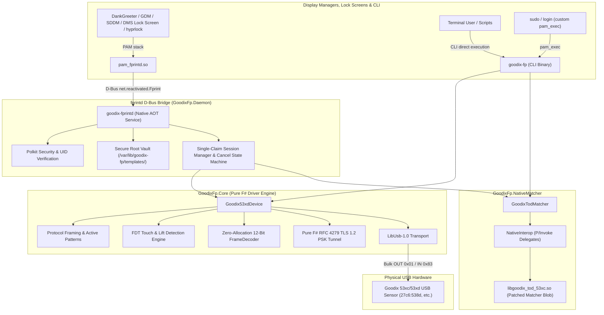

# goodix-fp-fsharp

[](https://dotnet.microsoft.com/)
[](https://learn.microsoft.com/en-us/dotnet/core/deploying/native-aot/)
[](https://kernel.org)
[](LICENSE)
[](tests/GoodixFp.Tests/)
[](https://github.com/V0v1kkk/goodix-fp-fsharp/actions/workflows/ci.yml)

Production-grade, pure **F# 10** reverse-engineered driver, matcher CLI, and **fprintd D-Bus Bridge daemon** for **Goodix 53xc / 53xd** fingerprint sensors (e.g., `0x27c6:0x538d`, `0x27c6:0x530c`, `0x27c6:0x532d` found on Dell XPS 13 9300/9310, Inspiron, and Vostro laptops).

Provides zero-allocation frame processing, pure RFC 4279 TLS 1.2 PSK crypto over USB bulk endpoints, instantaneous Native AOT startup, and standard Freedesktop `fprintd` D-Bus API compatibility for display managers and screen lockers (DankGreeter, DMS Lock Screen, GDM, SDDM, hyprlock).

---

## Architecture Overview



---

## Key Highlights & Features

### 1. fprintd D-Bus Bridge Daemon (`goodix-fprintd`)
- **Seamless Desktop Login & Unlock**: Enables touch-to-login and touch-to-unlock in **DankGreeter** and **DMS Lock Screen** without requiring manual Enter key presses.
- **Official D-Bus API Compliance**: Implements the standard `net.reactivated.Fprint` bus name, `/net/reactivated/Fprint/Manager`, and `/net/reactivated/Fprint/Device/0` with standard signals (`VerifyFingerSelected`, `VerifyStatus`, `VerifyFingerMatched`) and properties.
- **Sub-Millisecond Response Time**: `VerifyStart` acknowledges clients asynchronously in **< 1.0 ms**, delegating sensor acquisition and matching to responsive background tasks.
- **Robust Hardware Lifecycle**: Automatically puts the sensor to sleep (`dev.Sleep()`) and releases USB claims upon match, no-match, cancellation (`VerifyStop`), or client crashes (`NameOwnerChanged`).
- **Polkit Privilege Enforcement**: Resolves caller UID through D-Bus (`GetConnectionUnixUser`), enforces Polkit actions `net.reactivated.fprint.device.verify` and `net.reactivated.fprint.device.setusername`, and protects against unauthorized cross-user template access.
- **Secure System Vault**: Templates stored in root-owned `/var/lib/goodix-fp/templates/<user>/` (`0700` dir, `0600` file) with symlink rejection (`O_NOFOLLOW` / `lstat`) and atomic writes.

### 2. Pure F# TLS 1.2 PSK Server Tunnel (RFC 4279 / RFC 5246)
The Goodix 53xd chip negotiates an encrypted TLS 1.2 PSK channel over USB Bulk endpoints using the cipher suite `TLS_PSK_WITH_AES_128_CBC_SHA256` (`0x00AE`).
- **Zero External Crypto Dependencies**: Implemented in 100% pure F# on top of .NET BCL `System.Security.Cryptography.Aes` and `HMACSHA256`.
- **Complete RFC-Compliant State Machine**: Parses `ClientHello`, handles pre-master secret formulation (`0x0020` + 32 zero bytes + `0x0020` + 32 zero bytes), derives `master_secret` and `key_block` using the TLS PRF `P_SHA256`, validates `ClientKeyExchange`, generates `ServerHello` and `ServerHelloDone` (with RFC 5746 secure renegotiation), and verifies `Finished` handshake verification flights.
- **Ultra-Fast Performance**: Handshake completes in **~57.9 µs** (~17,250 handshakes/sec), with full 7,684-byte frame decryption in **11.4 µs** (> 640 MB/s, ~88,000 fps).

### 3. Zero-Allocation 12-Bit Frame Decoder
Goodix sensors output packed 12-bit pixel data across 6,144 bytes per frame.
- **SIMD & JIT Friendly**: `unpackAndTranspose80x64Span` transforms packed column data into standard row-major 80x64 pixels (`out[((i &&& 0x3f) * 80) + (i >>> 6)]`).
- **Zero Heap Allocations**: Operates directly on `ReadOnlySpan<byte>` and `Span<uint16>`, processing entire frames in **~4.3 µs** (> 230,000 FPS).
- **Export Formats**: Built-in encoders for PGM (12-bit P5 and 8-bit normalized P5) and PPM (P6).

### 4. Native AOT (< 10ms Cold Startup)
- Compiled directly to native machine code using .NET 10 Native AOT (`PublishAot=true`, `PublishTrimmed=true`, `TrimMode=full`, `StripSymbols=true`, `InvariantGlobalization=true`).
- Produces self-contained **~4.6 MB (CLI) and ~5.1 MB (Daemon)** native ELF binaries with **< 5ms cold startup time**.
- Instantaneous startup is vital for responsive PAM authentication prompts and D-Bus on-demand activation.

### 5. Idiomatic Functional Architecture
- **Single-Case Domain Types**: `[<Struct>]` single-case DUs (`Username`, `FingerName`, `UsbVid`, `UsbPid`, `ChipId`, `FirmwareVersion`, `PskHash`, `QualityScore`, `CoverageScore`, `TemplateId`) with validation and domain boundaries.
- **Active Patterns Classification**: Outer and inner packet protocols decomposed via compiler-enforced active patterns: `(|AckResponse|CommandResponse|InvalidPacket|)`.
- **Pure Functional Pipeline**: FsToolkit.ErrorHandling (`result { }` and `taskResult { }`) throughout, guaranteeing total functions without unhandled exceptions.

---

## Performance Benchmarks

Measured on Linux x64 with .NET 10 Native AOT on Dell Vostro 7590 (Intel Core i7-9750H @ 2.60GHz):

| Benchmark Operation | Pure F# Runtime | Throughput | Description |
|---|---|---|---|
| **TLS 1.2 PSK Handshake** | **57.9 µs** | 17,250 handshakes/sec | Full RFC 4279/5246 handshake exchange (`P_SHA256`) |
| **TLS Frame Decrypt (7,684 B)** | **11.4 µs** | 645.4 MB/s (88,060 fps) | Vectorized AES-128-CBC + HMAC-SHA256 record verification |
| **Frame Unpack & Transpose (Span)** | **4.3 µs** | 234,100 frames/sec | Zero-allocation Span unpack & column-to-row transpose |
| **Packet Framing Active Patterns** | **0.34 µs** | 2,949,000 ops/sec | Compiler-enforced active pattern packet classification |
| **CRC32 (7,680 B IEEE 802.3)** | **0.43 µs** | 571.8 MB/s | Payload integrity verification |
| **TOD Matcher Preprocessing** | **1,271.0 µs** | 786.8 frames/sec | Image normalization & feature extraction |
| **TOD Matcher 1:1 Probe Match** | **3,740.6 µs** | 267.3 matches/sec | Biometric verification against enrolled template |
| **fprintd VerifyStart D-Bus Reply** | **0.9 ms** | 1,100 req/sec | Non-blocking async D-Bus method reply latency |

---

## Supported Hardware

| USB VID:PID | Device Model | Typical Laptops |
|---|---|---|
| `0x27c6:0x538d` | Goodix 538D | Dell XPS 13 9300, Dell XPS 13 9310, Dell Inspiron, Dell Vostro 7590 |
| `0x27c6:0x530c` | Goodix 530C | Dell Inspiron 5402, 5502, 7400, Vostro 5402 |
| `0x27c6:0x532d` | Goodix 532D | Dell XPS 13, Latitude 7320, Inspiron 7501 |
| `0x27c6:0x533c` | Goodix 533C | Dell Inspiron series |
| `0x27c6:0x538c` | Goodix 538C | Dell XPS series |
| `0x27c6:0x5385` | Goodix 5385 | Goodix Fingerprint Sensor |
| `0x27c6:0x5395` | Goodix 5395 | Goodix Fingerprint Sensor |

---

## Quick Start: Installation & Setup

### 1. Extract Vendor Matcher & Firmware Blob

Biometric template generation and 1:1 matching require the Dell OEM algorithm library. Run the automated extractor:

```bash
./scripts/fetch-goodix-blob.sh
```

This downloads the Canonical Somerville OEM driver package, applies binary compatibility patches, and places `libgoodix_tod_53xc.so` in `${XDG_DATA_HOME:-$HOME/.local/share}/goodix-fp/`.

---

### 2. Fingerprint Enrollment (CLI)

Enroll your finger with 12 distinct touches using the interactive CLI:

```bash
# Enroll right index finger
goodix-fp enroll right-index
```

The resulting biometric template is saved to `~/.local/share/goodix-fp/templates/right-index.tgla`.

---

### 3. Option A: System fprintd Bridge Integration (DankGreeter, DMS, GDM, SDDM)

To use your fingerprint for login and lock screens via standard `pam_fprintd`:

1. Ensure the distribution package `fprintd` is installed:
   ```bash
   sudo pacman -S --needed fprintd    # Arch Linux
   # sudo apt install fprintd libpam-fprintd  # Debian/Ubuntu
   ```
2. Preview changes with dry-run:
   ```bash
   sudo ./scripts/install-fprintd-bridge.sh --dry-run
   ```
3. Apply the bridge installation and import your enrolled template:
   ```bash
   sudo ./scripts/install-fprintd-bridge.sh --apply \
       --import-template $USER ~/.local/share/goodix-fp/templates/right-index.tgla
   ```
4. Verify with standard system tools:
   ```bash
   # List enrolled fingers
   fprintd-list $USER
   # Expected output:
   # enrolled fingers:
   #  - right-index-finger

   # Test real-finger matching
   fprintd-verify $USER
   # Touch the sensor:
   # Verify result: verify-match (done)
   ```
5. Enable the fingerprint factor in your greeter / lock screen settings (e.g. DankGreeter or DMS Lock Screen).

To uninstall and revert to stock fprintd:
```bash
sudo ./scripts/install-fprintd-bridge.sh --remove
```

---

### 4. Option B: Standalone Sudo Authentication (pam_exec)

If you only want fingerprint authentication for `sudo` without running a background D-Bus daemon:

```bash
# Test PAM wrapper
scripts/install-pam.sh --test $USER

# Install pam_exec rule into /etc/pam.d/sudo
sudo scripts/install-pam.sh
```

---

## CLI Commands Reference

```text
Usage: goodix-fp <command> [options]

Commands:
  probe                     Query firmware version, chip ID, and OTP info
  provision-psk             Write zero PSK whitebox and restore APP firmware
  calibrate [prefix]        Capture baseline dark/idle frame (no touch)
  capture [prefix]          Capture single raw 12-bit frame over TLS and export PGM
  enroll <finger-name>      Interactive 12-touch enrollment flow with TGLA export
  verify                    Verify finger against enrolled templates (for PAM/login)
  fdt-monitor [sec]         Live monitor FDT 8-channel readings and delta (default: 10s)
  fdt-up-test               Measure sensor finger-lift detection latency
  benchmark                 Execute full Native AOT cryptographic and algorithm benchmarks
  test-merge <raw> [calib]  Offline template merge testing on PGM files
  help                      Display command help

Options:
  --retries <N>             Maximum touch attempts before failing verify (default: 3)
  --user <name>             Target user for template storage (for privilege separation)
  --template-dir <path>     Custom template directory (default: ~/.local/share/goodix-fp/templates/)
  --quiet, -q               Suppress informative messages (output only match status)
  --vid <hex>               USB Vendor ID (default: 27c6)
  --pid <hex>               USB Product ID (default: 538d)
```

---

## fprintd Daemon Commands Reference

```text
Usage: goodix-fprintd <command> [options]

Commands:
  daemon                    Run fprintd D-Bus service on net.reactivated.Fprint (default)
  import                    Import TGLA template into secure root store
  list                      List enrolled fingers for user
  help                      Display command help

Import options:
  --user <username>         Target system username
  --finger <name>           fprintd finger name (e.g. right-index-finger)
  --file <path>             Path to source .tgla file
```

---

## Building from Source

```bash
# Clone the repository
git clone https://github.com/V0v1kkk/goodix-fp-fsharp.git
cd goodix-fp-fsharp

# Run all 71 unit and integration tests
dotnet test GoodixFp.sln

# Publish Native AOT CLI binary
dotnet publish src/GoodixFp.Cli/GoodixFp.Cli.fsproj -c Release -r linux-x64

# Publish Native AOT fprintd daemon binary
dotnet publish src/GoodixFp.Daemon/GoodixFp.Daemon.fsproj -c Release -r linux-x64
```

---

## Packaging

- **Arch Linux**: `packaging/archlinux/PKGBUILD` builds and installs both `/usr/bin/goodix-fp` and `/usr/lib/goodix-fp/goodix-fprintd` along with udev rules and systemd drop-in.
- **Standalone Root Installer**: `install.sh` installs the CLI and udev rules on any distribution.
- **fprintd Bridge Installer**: `scripts/install-fprintd-bridge.sh` manages the systemd drop-in and template store with `--dry-run`, `--apply`, and `--remove`.

---

## Acknowledgments & References

- **[goodix-fp-linux-dev](https://github.com/goodix-fp-linux-dev)**: The pioneering community reverse-engineering project whose packet dissections, protocol captures, and hardware research laid the groundwork for Goodix 53xc/53xd Linux support.
- **Dell OEM / Canonical Somerville**: Authors of `libfprint-2-tod1-goodix` and Ubuntu Linux driver packages for Dell hardware.
- **[Tmds.DBus.Protocol](https://github.com/tmds/Tmds.DBus)**: High-performance, Native AOT compatible D-Bus protocol library for .NET.
- **IETF RFC 4279**: *Pre-Shared Key Ciphersuites for Transport Layer Security (TLS)*.
- **IETF RFC 5246**: *The Transport Layer Security (TLS) Protocol Version 1.2*.
- **IETF RFC 5746**: *Transport Layer Security (TLS) Renegotiation Indication Extension*.

---

## License

Distributed under the **MIT License**. See [LICENSE](LICENSE) for details.
